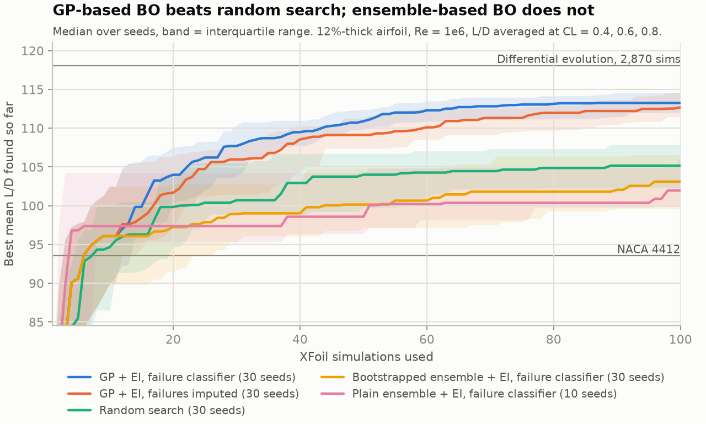
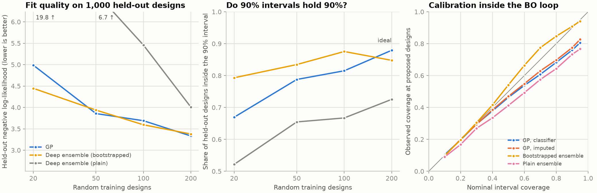
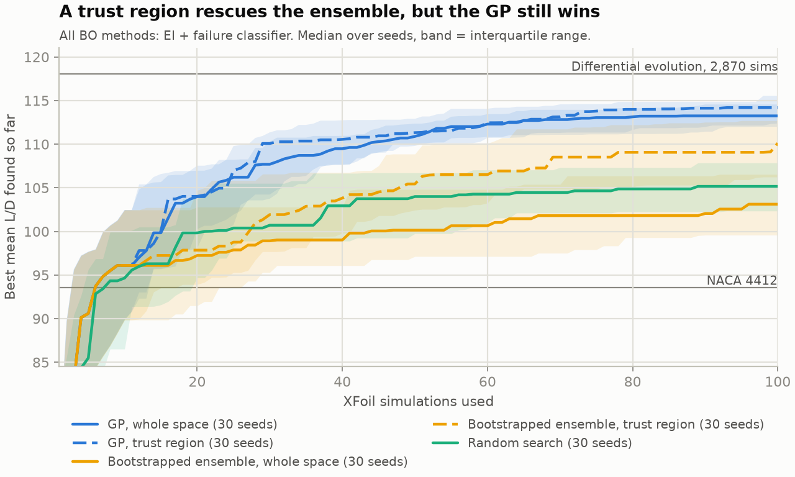
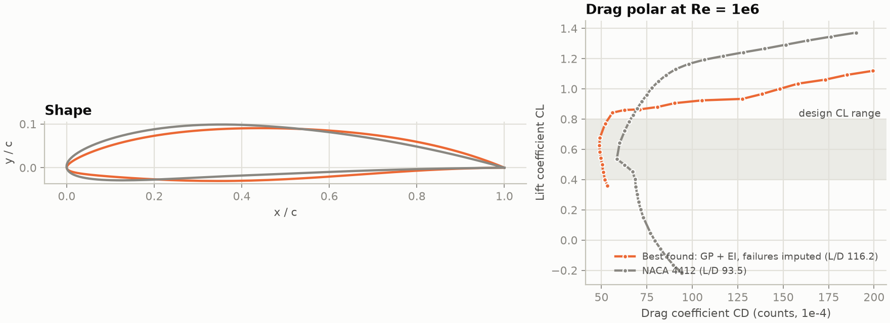

# airfoil-bo

Bayesian optimisation of a 2D airfoil with XFoil in the loop. A surrogate
model learns L/D from the shape, a GP classifier learns where XFoil fails
to converge, and the next shape to simulate is the one with the best
feasibility-weighted expected improvement. On top of that, a calibration
study asks whether the surrogate's uncertainty is honest, and whether
honest uncertainty actually finds better airfoils.

## The problem

- **Design space:** 7 numbers in [0, 1]. Each one sets a CST coefficient:
  3 control the thickness distribution and 4 control the camber line
  (`airfoil_bo/geometry.py`). Thickness is always rescaled to exactly **12%
  of the chord**, so every candidate meets the thickness requirement by
  construction.
- **Objective:** mean L/D at **CL = 0.4, 0.6 and 0.8**, at **Re = 10⁶**,
  with free transition (Ncrit 9). Averaging over three lift coefficients
  stops the optimiser from tuning a shape that only works at one point.
- **Unknown constraint:** a design fails if XFoil can't produce a clean
  polar through all three target CLs. That happens on about 18% of random
  designs, mostly ones that stall before CL 0.8.

## Methods compared

| Name | Surrogate | Failed designs |
|---|---|---|
| `gp_ei` | GP | GP classifier. The next design maximises log EI + log P(success). |
| `gp_ei_impute` | GP | Scored as the worst L/D seen so far, a common shortcut. |
| `ens_ei` | Deep ensemble of 5 MLPs, each trained on a bootstrap resample | GP classifier |
| `ens_ei_plain` | Deep ensemble with the plain recipe (no bootstrap) | GP classifier |
| `gp_ei_tr`, `ens_ei_tr` | As `gp_ei` / `ens_ei`, but the acquisition is optimised only inside a TuRBO-style trust region around the best design | GP classifier |
| `random` | — | — |
| `llm_high` | None. Claude (an LLM) picks every design itself, using its own knowledge of aerodynamics (`airfoil_bo/agent.py`) | Claude sees which target CLs failed and decides what to do |
| `scripts/reference.py` | Differential evolution with 2,870 simulations, the brute-force "best known" reference | |

Every BO method starts from 10 Sobol points and gets 100 XFoil simulations
in total. The Claude agent gets the same 100 simulations but no initial
design.

## Setup

```bash
tools/setup_xfoil.sh                 # XFoil from the Ubuntu package, no sudo needed
python3 -m venv .venv && .venv/bin/pip install -r requirements.txt
```

## Run

```bash
.venv/bin/python scripts/benchmark.py --seeds 30                          # ~2.5 h on 12 cores
.venv/bin/python scripts/benchmark.py --methods ens_ei_plain --seeds 10   # ~25 min
.venv/bin/python scripts/benchmark.py --methods gp_ei_tr ens_ei_tr        # ~1.5 h
.venv/bin/python scripts/reference.py                                     # ~10 min
.venv/bin/python scripts/dataset.py --seed 1000 --out results/data/train_pool.json
.venv/bin/python scripts/dataset.py --seed 2000 --out results/data/test.json
.venv/bin/python scripts/calibration.py                                   # ~10 min
.venv/bin/python scripts/analyze.py                                       # tables + figures in results/
```

### LLM in the loop

`scripts/agent.py` hands the loop to Claude instead of a surrogate model
(`airfoil_bo/agent.py`). Claude gets one tool, `simulate`, which runs XFoil
on up to 8 designs per call. The tool uses the same objective and the same
budget accounting as the benchmark. For each design Claude sees the per-CL
alpha, drag, L/D and moment plus a few shape numbers, and it has to give a
one-line rationale for each batch. Runs are saved to `results/agent/`, with
records in the same format as `results/runs/` plus the batch and the
rationale. The model, effort level and token usage are saved in each run file.

```bash
export ANTHROPIC_API_KEY=...
.venv/bin/python scripts/agent.py --budget 30 --effort medium   # smoke test, one run
.venv/bin/python scripts/agent.py --runs 10 --parallel 4        # the comparison: 10 runs x 100 sims, effort high
.venv/bin/python scripts/analyze.py                             # adds them to summary.md and llm_vs_gp.png
```

`analyze.py` only uses agent runs with a 100-simulation budget, so smoke
tests don't leak into the comparison.

Only the system prompt and the `simulate` tool are specific to XFoil. To
put a CAD script in the loop instead, replace those two.

## Results

### Optimisation

The table below covers 30 seeds per method (10 for `ens_ei_plain`); it is
also in `results/summary.md` along with the full significance table.

| Method | Median best L/D after 20 / 50 / 100 sims | Median gap to best known at 100 sims | Sims to match random search's 100-sim median (105.2) | Failed sims | Time per proposal |
|---|---|---|---|---|---|
| GP + EI, failure classifier | 104.0 / 110.9 / **113.2** | 4.8 (4.1%) | **22** | 6% | 5.4 s |
| GP + EI, failures imputed | 101.7 / 109.1 / 112.7 | 5.4 (4.6%) | 25 | 5% | 2.3 s |
| Random search | 99.8 / 104.0 / 105.2 | 12.9 (10.9%) | - | 18% | - |
| Bootstrapped ensemble + EI | 97.2 / 100.1 / 103.1 | 15.0 (12.7%) | not reached | 34% | 9.3 s |
| Plain ensemble + EI (10 seeds) | 97.4 / 98.6 / 102.0 | 16.1 (13.6%) | not reached | 51% | 8.1 s |

References:
- Differential evolution: **118.1** after 2,870 simulations (the best known value).
- Standard airfoils: NACA 4412 93.5, NACA 2412 88.9, NACA 0012 65.1.



- **GP-based BO beats random search by a wide margin** (one-sided
  Mann–Whitney on the final best: p < 10⁻¹⁰). Both GP variants match
  random search's 100-simulation result in 22–25 simulations. With 100
  simulations they get within 4–5% of an optimum that took differential
  evolution 29× as many.
- **The failure classifier is not clearly better than imputation.** In
  the first 10-seed run it looked slightly better. With 30 seeds the gap shrinks
  to about 0.5 L/D (p = 0.09), and the classifier costs more than twice
  as much per proposal. When simulations are this cheap, imputation is
  the pragmatic default. Where the classifier does earn its place is
  calibration (below).
- **Deep-ensemble BO is worse than random search** (p = 0.02 bootstrapped,
  p = 0.04 plain). It fails a third to half of its simulations. The next
  section explains why.

### Is the uncertainty honest?



Full tables are in `results/calibration.md`.

**On held-out random designs** (trained on n random designs, tested on
1,000 others):

| Training designs | GP: 90% interval holds | Bootstrapped ensemble: 90% holds | Plain ensemble: 90% holds |
|---|---|---|---|
| 20 | 67% | 79% | 52% |
| 50 | 79% | 83% | 65% |
| 100 | 82% | 88% | 67% |
| 200 | 88% | 85% | 73% |

- **The GP is overconfident with little data and becomes honest as data
  grows.** That's the usual symptom of fitting kernel hyperparameters by
  point estimate on a handful of points. It has the lowest prediction
  error from 50 points up.
- **The bootstrapped ensemble is better calibrated at small n.** Its NLL
  is essentially tied with the GP's. Bootstrapping is the fix that
  matters: the plain recipe is overconfident at every size. (The ensemble
  settings were chosen on data from the first benchmark, not on this test
  set.)
- **The failure classifier clearly beats guessing the base rate**
  (Brier score 0.064 vs 0.150 at 100 points), but it helps little at 20
  points.

**Inside the BO loop.** Each proposal logged its prediction before XFoil
ran:

| Method | 90% interval holds | Median (actual − predicted) L/D | Predicted P(success) | Actual success |
|---|---|---|---|---|
| GP + EI, failure classifier | 76% | −1.7 | 95.4% | 95.4% |
| GP + EI, failures imputed | 78% | −2.0 | - | - |
| Bootstrapped ensemble + EI | 91% | −11.5 | 72.9% | 64.8% |
| Plain ensemble + EI | 73% | −7.5 | 51.9% | 45.8% |

- **Every method is optimistic at its own proposals: the winner's curse.**
  EI picks the designs where the model's errors happen to be optimistic,
  so outcomes land below the predictions even for a model that is
  calibrated on random points.
- **The GP classifier is almost perfectly calibrated in the loop.** It
  predicted 95.4% success on average, and 95.4% of designs succeeded.

**So does honest uncertainty find better airfoils? Not here.** The
bootstrapped ensemble had the most nominal coverage in *both* tests and
still optimised worst. What decides it is behaviour away from the data:

- **A GP falls back to its prior mean there**, so EI weighs mean against
  variance sensibly.
- **Neural networks extrapolate trends linearly**, so EI is largest on
  the edges of the box. **86%** of the bootstrapped ensemble's proposals
  had at least 5 of the 7 parameters at a bound, against **3%** for the
  GP.
- **The ensemble kept proposing corners it had already tried.** A lone
  point at a corner is left out of about a third of the bootstrap
  resamples, so those members keep extrapolating there.
- **The classifier can't stop this.** Far from the data it predicts about
  90% success.

Calibration is necessary but not sufficient. How the model extrapolates
matters as much as how its errors are distributed. The trust-region
experiment below tests this directly.

### Trust regions: removing the extrapolation

If corner-seeking is what sinks the ensemble, then forbidding it should
help. The trust-region variants keep everything else identical (same EI,
same classifier, same budget) and only restrict where the acquisition is
optimised: a box around the best design so far. As in TuRBO-1:

- **Size:** the box starts at 0.8 of the unit cube per side. It doubles
  after 3 improvements in a row and halves after 7 misses in a row.
- **Shape:** for the GP, the box is stretched per parameter by the
  model's length scales. The ensemble has none, so its box is a cube.
- **Collapse:** if the box shrinks below 0.5⁷, it re-expands around the
  incumbent rather than restarting globally.



| Method (30 seeds each) | Median best L/D at 100 sims | Sims to match random search's 100-sim median | Failed sims | Proposals at a corner | Median (actual − predicted) L/D in the loop |
|---|---|---|---|---|---|
| GP, whole space | 113.2 | 22 | 6% | 3% | −1.7 |
| GP, trust region | **114.2** | 24 | 4% | 1% | −0.4 |
| Bootstrapped ensemble, whole space | 103.1 | not reached | 34% | 86% | −11.5 |
| Bootstrapped ensemble, trust region | 110.1 | 50 | 10% | 6% | +0.8 |
| Random search | 105.2 | - | 18% | - | - |

- **The trust region rescues the ensemble.** Its median rises from
  103.1 to 110.1 (p ≈ 10⁻⁶), and it now beats random search
  (p < 10⁻⁴). The mechanism is confirmed: corner proposals drop from 86%
  to 6%, and its in-loop optimism vanishes (−11.5 → +0.8 L/D), with 90%
  intervals that hold 91%.
- **The GP still wins.** The GP with a trust region beats the ensemble
  with a trust region by 4 L/D (p = 3·10⁻⁶) and needs half as many
  simulations to match random search. With the extrapolation problem
  removed, what's left is the GP's lower prediction error from 50 points
  up (see the static table).
- **For the GP, the trust region is a small, free improvement.** It adds
  1 L/D (p = 0.13 vs the whole-space GP, so not significant) and makes
  proposals faster (3.7 s vs 5.4 s), probably because optimising the
  acquisition over a smaller box converges sooner. It also produced the single best design of any run
  (L/D 117.3, within 0.7% of the differential-evolution optimum).

### Does knowing aerodynamics help? Claude vs the GP

The GP has no prior knowledge: it learns L/D from the numbers alone.
Claude has never seen this objective, but it knows aerodynamics: drag
buckets, aft loading, leading-edge radius, stall. The question is whether
that knowledge beats a GP with no prior on the same 100 simulations.
Either answer is worth knowing. Beyond who wins, the analysis also checks
whether an early lead fades and whether the agent wastes simulations
(repeated designs, unused budget, failures).

**This is not an equal comparison.** The two differ in what they are told
and how they work:

- **Richer feedback.** For every simulation, Claude sees alpha, CD, L/D
  and CM at each target CL, which target CLs failed to converge, the
  maximum camber and its position, and the position of maximum thickness.
  The GP sees one number (mean L/D) and a success flag.
- **A described design space.** The prompt says what each parameter does
  physically (leading-edge bluntness, aft thickness, camber from leading
  to trailing edge). For the GP they are 7 anonymous coordinates.
- **Facts from this study.** The prompt gives the NACA 4412 score (93.5)
  and the ~18% failure rate of random designs, both measured here. It does
  not give the differential-evolution optimum (118.1) or anything from
  the BO runs.
- **Its own knowledge of aerodynamics.** That's the point of the
  question, but it means the 100-simulation budget doesn't count
  everything that went into Claude's choices.
- **Batches instead of single proposals.** Claude picks up to 8 designs
  per call; the GP picks one at a time. This cuts both ways: the GP
  updates after every simulation, while Claude sees results less often
  but plans each batch as a whole and gets them back faster (XFoil runs
  in parallel).
- **No initial design.** The BO methods spend their first 10 simulations
  on Sobol points. Claude chooses all 100 itself.
- **Fewer runs.** Agent runs cost money and time, so there are 5–10 of
  them against 30 seeds per BO method. The Mann–Whitney p-values in
  `results/summary.md` take the sample sizes into account, but the
  interquartile band on the plot is noisier.
- **Not exactly reproducible.** There's no seed. Results belong to the
  model version and effort level recorded in each run file and may change
  with a newer model.
- **Different costs.** A GP proposal costs a few seconds of CPU. An agent
  run costs API tokens and minutes of model time. `results/summary.md`
  reports tokens, dollars and wall time per run.

Results: *pending. Run the commands under
[LLM in the loop](#llm-in-the-loop), then fill this in from
`results/summary.md` and `results/llm_vs_gp.png`.*

### The best airfoil



The best shape found by any BO run (L/D 117.3, GP with trust region) and
the differential-evolution optimum (118.1) are nearly the same
laminar-flow design:

| | Max thickness at | Max camber |
|---|---|---|
| Best BO run | 40% chord | 3.3% at 56% chord |
| Differential evolution | 41% chord | 3.5% at 56% chord |
| NACA 4412 (for comparison) | 30% chord | 4% at 40% chord |

Moving the thickness and camber aft keeps the pressure gradient
favourable over more of the chord. That delays transition, so drag stays
flat at about 50 counts across CL 0.3–0.8, with the edge of the low-drag
bucket placed just above CL 0.8.

## XFoil gotchas (handled in `airfoil_bo/xfoil.py`)

1. **The Ubuntu binary crashes with SIGFPE** in the viscous solver. It is
   compiled with floating-point traps enabled. The fix is to preload
   `tools/libnofpe.so`, which turns the trap setup off.
2. **Jumping straight to a target CL gives spurious solutions.** The
   `CL 0.4` command started from α = 0 converged to drag below a
   *fully laminar flat plate*. The objective now sweeps α outward from 0°
   in 0.5° steps and interpolates at the target CLs. Points where CD < CDf
   are rejected.
3. **One failed point poisons the rest of a scripted sweep.** XFoil is now
   driven interactively, and each point that fails is retried once from a
   fresh boundary layer. That cut failures on random designs from 42% to
   20%. Both sweep directions now start from the α = 0 solution.
4. **Most low-CL failures are real, not artifacts (tested and rejected).**
   In the first GP runs, about a quarter of the failures were at the
   low-CL end (CL 0.4, sometimes also 0.6) while CL 0.8 was fine. I
   suspected the cold restart of the downward sweep, but fixing it
   rescued only 3 of the 52 designs that failed at CL 0.4. They are
   heavily cambered shapes whose lower surface separates at the negative
   α needed for CL 0.4. Finer steps and 200 iterations rescue about half
   of them, but their drag at CL 0.4 is 55–190 counts (against ~50 for
   good designs), so they are genuinely poor there. The solver settings
   stay as they are and the classifier absorbs these failures.

## Caveats

- **This is the XFoil optimum, not the real-world optimum.** At Ncrit 9
  (a clean wind tunnel), XFoil rewards long laminar runs. Surface
  roughness or turbulence would trip transition and erase most of the
  gain.
- **XFoil is a viscous–inviscid panel method.** Drag near stall is
  unreliable.
- **The ensemble results cover this setup only:** 7 dimensions and ≤100
  points. Ensembles may catch up with more data or in higher dimensions,
  where GPs struggle.
- **The trust region is TuRBO-1's box logic only.** It keeps EI with the
  classifier instead of TuRBO's Thompson sampling, and it re-expands
  instead of restarting, so that the comparison isolates the effect of
  the search region.

## Next steps

1. **Fully Bayesian GP hyperparameters** (MCMC / SAAS) to fix the GP's
   overconfidence at small n, then check whether that helps optimisation.
2. **Full TuRBO:** Thompson sampling inside the trust region and batch
   proposals (12 designs per step, one per core). Compare wall-clock time
   rather than simulation count.
3. **A harder, robust objective:** average over Ncrit 5 and 9, and use
   12–14 shape parameters. Random search should fall much further behind
   there, and it's where trust regions usually matter most.
4. **Multi-fidelity:** NeuralFoil (milliseconds) as the cheap source and
   XFoil as the accurate one.

## Changes since the first version

**Third round:** added the trust-region variants (`TrustRegion` in
`airfoil_bo/bo.py`; `gp_ei_tr` and `ens_ei_tr`, 30 seeds each). Added a
"Proposals at a corner" column to `results/summary.md` and a new figure,
`results/trust_region.png`.

**Second round:**

- **Solver:** both sweep directions now warm-start from α = 0.
- **Benchmark:** 30 seeds instead of 10, plus the two ensemble methods.
- **Classifier fit:** L-BFGS instead of Adam. Proposals are about 1.7×
  faster (9.3 s → 5.4 s), and the old Adam fit hadn't converged.
- **Calibration:** every proposal logs its prediction, and there is a new
  calibration study (`scripts/dataset.py`, `scripts/calibration.py`).
- **Revised conclusion:** the first version's hint that the classifier
  beats imputation (p = 0.15 at 10 seeds) didn't hold up. With 30 seeds
  the difference is ~0.5 L/D and still not significant (p = 0.09).
